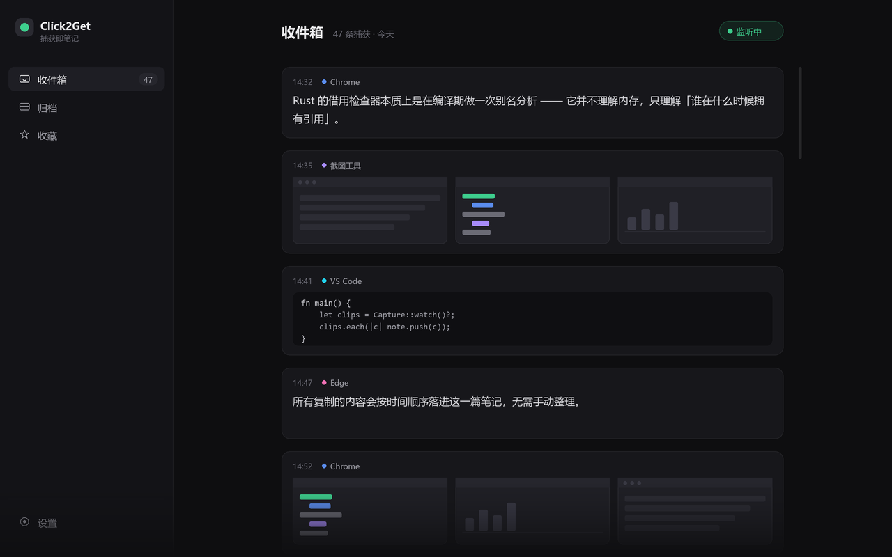

# Click2Get 技术方案 v2

> **定位**：低内存 + 现代化界面，两者都要。
> **结论**：Tauri 2 + WebView2 **三态生命周期管理**。核心思路是——
> WebView2 的内存成本在"引擎"，不在"内容"，而引擎是可以被杀掉的。

> v1（Rust + egui 全原生）保留在 `docs/技术方案.md` 作为降级备选，不再作为主线。

---

## 1. 先把两个词量化

模糊的目标无法验证，先钉死。

### "内存小" 分三档（用户感知的是常驻态，不是峰值）

| 状态 | 触发条件 | 目标 | 说明 |
|---|---|---|---|
| **S0 睡眠** | 窗口关闭 / 托盘常驻 | **≤ 35 MB** | 只剩 Rust 主进程 + 托盘图标 |
| **S1 挂起** | 窗口隐藏 / 最小化 | **≤ 75 MB** | 引擎存活但缓存被刷出 |
| **S2 活动** | 窗口可见、正在编辑 | **≤ 160 MB** | 正常渲染 |

对标参照：微信 PC 200–400 MB、Notion 300 MB+、Slack 400 MB+。
S2 的 160 MB 在这个参照系里属于"正常"，而不是"臃肿"。

### "现代化" 拆成两层

| 层 | 内容 | Web 的优势 |
|---|---|---|
| **静态视觉** | 字体渲染、间距、层次、色彩、圆角、图片展示 | 决定性（DirectWrite 全栈） |
| **交互动效** | hover 过渡、展开收起、列表入场、滚动惯性 | 决定性（CSS + 合成器线程） |

这两层恰好都是原生自绘框架的短板，所以"现代化"这一项基本只能在 Web 侧拿。

---

## 2. 核心架构：WebView2 三态生命周期

### 2.1 状态机

```
                    ┌──────────────┐
   托盘点击 ────────►│   S2 活动    │◄─── 有焦点
        ▲           │  ≤160 MB     │
        │           └──────┬───────┘
        │                  │ 失焦 / 最小化
        │                  ▼
        │           ┌──────────────┐
        │           │  S1 挂起     │
        │           │  ≤75 MB      │
        │           └──────┬───────┘
        │                  │ 关闭 / 60s 无交互
        │                  ▼
        │           ┌──────────────┐
        └───────────│  S0 睡眠     │
        重建窗口    │  ≤35 MB      │
                    └──────────────┘
```

### 2.2 每一档的具体手段

**S2 → S1（挂起）**
```
ICoreWebView2_19::SetMemoryUsageTargetLevel(COREWEBVIEW2_MEMORY_USAGE_TARGET_LEVEL_LOW)
ICoreWebView2_3::TrySuspendAsync()      // 挂起渲染进程，暂停脚本
```
微软官方文档明确说明这会"提示浏览器引擎删除缓存的数据或将内存交换到磁盘"。

**S1 → S0（睡眠）**
直接销毁整个 WebviewWindow，`msedgewebview2.exe` 的全部子进程随之退出。
Rust 主进程继续跑剪贴板监听线程——**捕获功能不受影响**，这是关键：
用户关掉窗口，复制的东西照样记进去。

**S0 → S2（唤醒）**
重建 `WebviewWindowBuilder`。冷启动 300–500 ms，用下面两种方式掩盖。

### 2.3 冷启动掩盖（体验的关键）

微软文档明确建议："不要把 WebView2 用于初始 UI"。所以：

1. 托盘点击 → **立即** `show()` 一个原生窗口，内容是一张静态骨架图（PNG，几十 KB，Rust 侧直接上屏）
2. 同时立刻开始重建 WebView2
3. 150 ms 后 WebView 挂载完成，骨架淡出（纯 CSS opacity，200 ms）

用户感知：**点下去窗口立刻就出来了**。那 400 ms 被骨架屏吃掉。

### 2.4 一个用户可调的旋钮

| 模式 | 常驻内存 | 打开延迟 | 适合 |
|---|---|---|---|
| **极省模式**（默认） | 25–35 MB | ~400 ms | 内存敏感的机器 |
| **秒开模式** | 60–75 MB | ~50 ms（预创建挂起窗口） | 主力机 |

把"内存 vs 速度"的矛盾变成一个设置项，而不是一个产品缺陷。

### 2.5 其他压内存的开关

```js
// tauri.conf.json → windows.additionalBrowserArgs
"--js-flags=--max-old-space-size=192"    // 给 JS 堆设硬顶，防止长会话膨胀
"--disable-background-networking"
"--disable-component-update"
"--disable-sync"
"--renderer-process-limit=1"
```

---

## 3. 图片管线（内存第二杀手）

沿用 v1 的结论，但实现更省：**不自己管纹理，交给 Chromium**。

```
捕获（Rust 线程）                     展示（WebView）
  PNG 解码                                .thumb.png"
  → <sha256>.png（原图）                          loading="lazy">
  → <sha256>.thumb.png（长边 512）        ↑
  → 写入 %LOCALAPPDATA%                    Chromium 自己按需解码、自己回收
```

- 自定义协议 `c2g://`（Tauri `register_asynchronous_uri_scheme_protocol`）直接读文件流，
  **图片字节永远不进 JS 堆**
- 列表里只加载缩略图；双击看大图才请求原图
- 内容寻址去重：同一张图复制 10 次只占一份磁盘

这就是为什么 Web 方案的图片内存反而不比原生方案差——浏览器的图片缓存是 C++ 实现的，
比你在 JS 里管 `<canvas>` 或自己维护纹理 LRU 高效得多。

---

## 4. 界面现代化：具体规范

"现代化"不是形容词，是可以写成清单的。



> 上面这张界面稿是按本节规范渲染的，`docs/mockup.py` 是生成脚本，改参数即可迭代。

### 4.1 视觉基调

参考坐标：**Linear 的克制 + Notion 的内容优先**，暗色优先。

| 项 | 规范 | 反例（避免"土"） |
|---|---|---|
| 字体 | Inter / MiSans + 思源黑体（中文） | 默认微软雅黑不加字重 |
| 正文 | 15px / 行高 1.75 / 字距 0 | 14px 挤在一起 |
| 色板 | 中性 11 级灰 + **单一**强调色 | 五颜六色的标签 |
| 底色 | 分层：#0E0E10 → #16161A → #1E1E23 | 纯黑 `#000` |
| 文字 | 主 #EDEDEF / 次 #A0A0A8 / 弱 #6B6B75 | 纯白 `#FFF` |
| 圆角 | 控件 8 / 卡片 12 / 浮层 16 | 一律 4px |
| 间距 | 4 的倍数，主用 8/12/16/24 | 随手写 13px |
| 分割线 | `rgba(255,255,255,.06)`，1px | 深色实线描边 |
| 阴影 | `0 1px 2px rgba(0,0,0,.3), 0 8px 24px rgba(0,0,0,.24)` | 不用阴影靠描边 |
| 动效 | 160 ms `cubic-bezier(.2,0,0,1)` | `0.2s ease` |
| 滚动条 | 6px overlay，hover 才显形 | 系统粗滚动条 |

### 4.2 布局

```
┌──────────────┬─────────────────────────────────────────┐
│  Click2Get   │  收件箱                         ⏸ ●    │
│              │  ─────────────────────────────────────  │
│  ● 收件箱 47 │   ┌─ 14:32 · Chrome ─────────────────┐  │
│  ○ 归档      │   │ Rust 的 borrow checker 本质上…   │  │
│  ○ 收藏      │   └──────────────────────────────────┘  │
│              │   ┌─ 14:35 · 截图工具 ───────────────┐  │
│  ──────────  │   │ ┌───────┐ ┌───────┐ ┌───────┐    │  │
│  ⚙ 设置      │   │ │ 缩略  │ │ 缩略  │ │ 缩略  │    │  │
│              │   │ └───────┘ └───────┘ └───────┘    │  │
│              │   └──────────────────────────────────┘  │
│              │   ┌─ 14:41 · VS Code ────────────────┐  │
│              │   │ fn main() { … }                  │  │
│              │   └──────────────────────────────────┘  │
└──────────────┴─────────────────────────────────────────┘
   240px              内容区最大 720px 居中
```

要点：
- 每条捕获是**一张卡片**，卡片头是「时间 · 来源应用」，正文是内容
- 图片块用**固定高度的横向缩略图条**，不是大图铺满（省空间、更像"收集"而非"阅读"）
- 状态栏常驻一个**监听开关**，绿色圆点表示正在捕获——这是用户唯一需要随时确认的状态
- 卡片 hover 才浮出操作（复制/删除/转笔记），静止时保持干净

### 4.3 建议加的两个"高级感"细节

1. **捕获时的入场动效**：新卡片从顶部滑入 8px + 淡入 220 ms。用户会感到"它在工作"。
2. **来源色点**：不同应用的小圆点用不同低饱和色（Chrome 蓝、VS Code 青、截图工具紫），
   不破坏中性色调，但提供了可扫读的信息。

---

## 5. 编辑器：TipTap

选 `@tiptap/core` 3.32（ProseMirror 封装，headless）：比自己拼 ProseMirror 省 3–5 天，
又比 Lexical 的中文生态成熟。

```ts
// 自定义图片节点，src 指向自定义协议
const CaptureImage = Node.create({
  name: 'captureImage',
  group: 'block',
  atom: true,
  addAttributes: () => ({ hash: {}, w: {}, h: {} }),
  parseHTML: () => [{ tag: 'img[data-c2g]' }],
  renderHTML: ({ HTMLAttributes }) => ['img', {
    ...HTMLAttributes,
    src: `c2g://local/${HTMLAttributes.hash}.thumb.png`,
    'data-c2g': '',
    loading: 'lazy',
  }],
})
```

编辑器本身做**块级卡片**而不是连续文档：每个捕获是一个自定义 node，视觉上是一张卡片，
语义上是一个块。这样既有富文本能力（跨块选择、行内加粗、撤销栈），又保持了"收集流"的视觉。

**大文档保护**：单篇笔记超过 2000 块时提示归档。ProseMirror 处理 2000 个块节点没问题，
但再往上滚动会开始掉帧。

---

## 6. 其余部分（沿用 v1，已验证可行）

| 模块 | 方案 |
|---|---|
| 剪贴板监听 | 独立线程 + 隐藏窗口 + `AddClipboardFormatListener`（事件驱动，空闲 0 CPU） |
| 排除隐私格式 | 尊重 `ExcludeClipboardContentFromMonitorProcessing`（密码管理器会置位） |
| 防自捕获 | 写剪贴板时打 `Click2GetOwned` 标记格式 |
| 存储 | SQLite（WAL）+ 图片文件 + SHA-256 内容寻址 |
| 搜索 | FTS5 `trigram` 分词器（`unicode61` 切不了中文） |
| 托盘 / 热键 / 自启 | `tray-icon` + `RegisterHotKey` + Run 注册表 |
| 单实例 | `CreateMutexW("Global\\Click2Get")`，二次启动唤醒已有实例 |

---

## 7. 里程碑

| 阶段 | 内容 | 估时 |
|---|---|---|
| **M0 闸门** | Tauri 骨架 + 托盘 + 剪贴板线程 + **三态内存实测** | 1.5 天 |
| M1 数据层 | SQLite + 图片落盘/去重/缩略图 + 自定义协议 | 2 天 |
| M2 编辑器 | TipTap + 自定义卡片节点 + 图片块 + 捕获实时插入 | 3 天 |
| M3 视觉 | 设计规范落地、暗色主题、动效、骨架屏 | 2 天 |
| M4 生命周期 | 三态状态机、挂起 API、冷启动掩盖、秒开/极省模式 | 2 天 |
| M5 收尾 | 搜索、导出、开机自启、打包签名 | 2 天 |

约 **2.5 周**。

> **M0 是第一优先级**：三档内存必须实测到位再往下做。
> 如果 S0 压不到 40 MB（说明 WebView2 进程没真正退出），
> 就在 M0 就转 v1 的 egui 路线，沉没成本 1.5 天。

---

## 8. 风险

| 风险 | 对策 |
|---|---|
| WebView2 进程在窗口关闭后残留 | M0 用 Process Explorer 逐个核对；必要时显式 `Destroy()` + 等待句柄退出 |
| S1 挂起后恢复有 100–300 ms 白屏 | 恢复时先淡入缓存的静态截图，再 resume |
| 冷启动 400 ms 让"秒开"预期落空 | 骨架屏 + 秒开模式兜底 |
| 两个 WebView2 实例（如预览窗）内存翻倍 | 强制单 webview，预览用浮层不用新窗口 |
| 用户机器缺 WebView2 运行时 | Win11 自带；Win10 用 bootstrapper 静默安装（Evergreen） |

---

## 9. 降级路径（如果 160 MB 仍然不可接受）

三条备选，按"美观 / 内存"排序：

| 方案 | 内存 | 美观度 | 代价 |
|---|---|---|---|
| Slint 1.18 | 40–70 MB | ★★★☆ | 文本输入弱，块编辑器自建 |
| Rust + egui 深度定制 | 35–60 MB | ★★☆ | 字体渲染上限低，中文糊 |
| `WebviewWindow` 只用于编辑，列表用原生绘制 | 80–110 MB | ★★★★ | 两套渲染，复杂度翻倍 |

我建议先做 M0 实测，用数字说话再决定要不要降级。